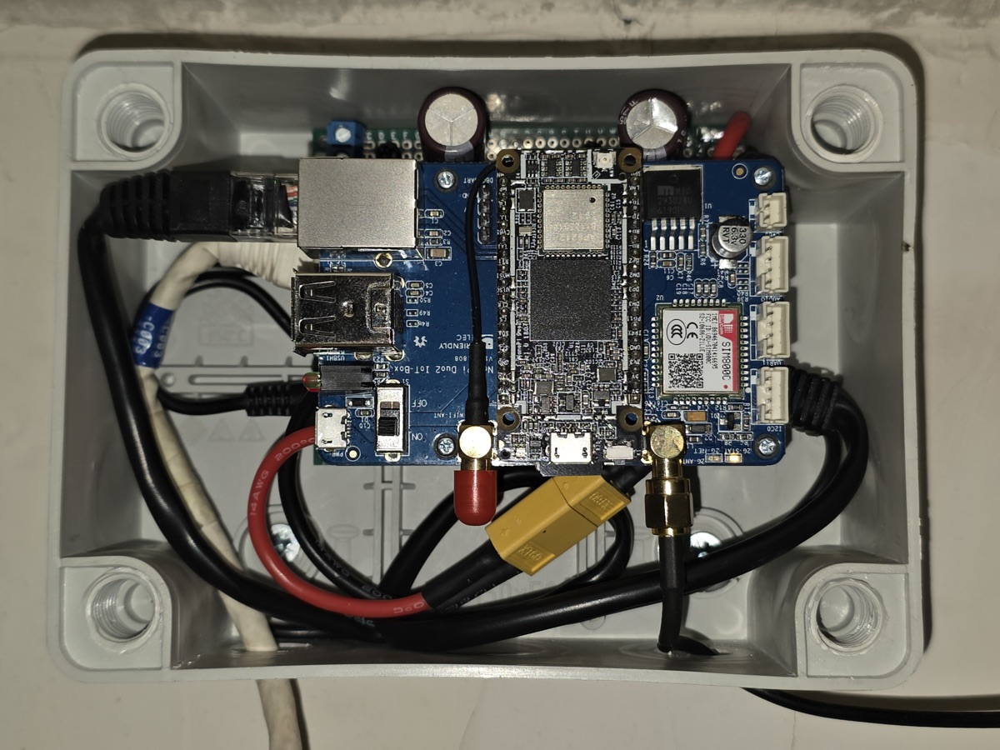
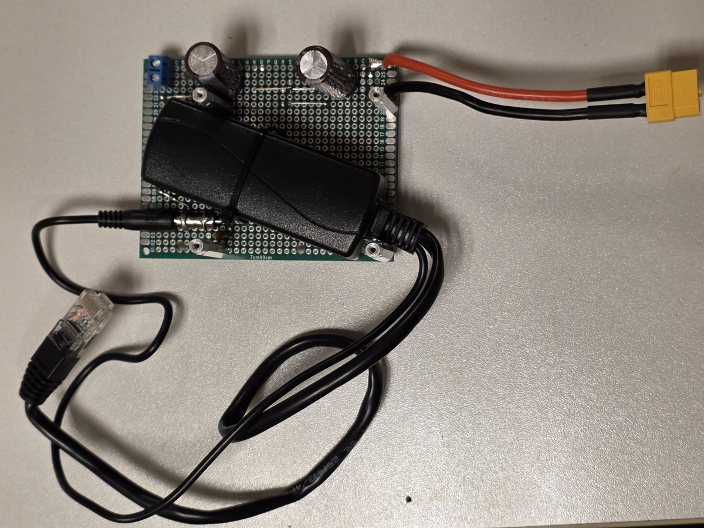

# SIM terminal program

A terminal program written in C++ for using a SIM module with Linux. The program keeps a permanent connection to the SIM module's UART port, handles incoming events and runs predefined commands or raw **AT** commands.

Incoming calls are hung up as soon as the **RING** event arrives. This protects against phone scammers who use social engineering, so it is safe to use a SIM card that is linked to a bank account or to other services with 2FA.

When the **+CMTI** event arrives, the program reads and prints the received SMS message. The message stays in the SIM storage, and read messages are deleted when the storage is nearly full.

The **+CUSD** event prints a USSD message.

A SIM card that is always online makes 2FA theft harder. Such attacks often use the IMEI, IMSI and phone number captured from your mobile device to take over accounts protected by SMS 2FA. Avoid SMS 2FA when possible and use TOTP 2FA instead.

The program has been compiled and tested on Armbian Linux for the NanoPi Duo2 with the NanoPi IoT-2G SIM800C dock. It should also work on other Linux systems with other Simcom modules. Check how the PWRKEY pin is connected on your board: on the IoT-2G dock, the PG11 pin controls PWRKEY with inverted logic. The GSM antenna included with the IoT-2G dock can interfere with the system, so it is better to use an antenna with an SMA cable that can be placed away from the board.

The service writes the full log to the system journal under the unit **sim-terminal**.

Use the **sim-shell** console script to connect to the terminal. You can type either **AT** commands or predefined commands.

**Predefined commands:**

- **kill**: stops the service.
- **quit**: disconnects the client.
- **balance**: requests the phone balance with the USSD code `*111#`. If your operator uses a different code, change `USSD_BALANCE_` in `sim-terminal.cc` and rebuild the program (see below).
- **send**: sends an SMS message.

## Power supply

The SIM800 draws current peaks of up to 2 A during GSM transmission. If the supply voltage drops below about 3.4 V, the module resets itself and loses its settings. Use a power supply that can deliver at least 2 A and add large electrolytic capacitors (1000 µF or more) close to the module's power input. You can find **UNDER-VOLTAGE** or **RDY** messages in the journal if the module resets.

## How to install

Software requirements:

    g++-10.2+       # apt install build-essential
    nc.traditional  # apt install nc.traditional
    libgpiod-2.0+   # apt install libgpiod-dev

Run the following commands:

	make
	sudo make install
	sudo systemctl start sim-terminal
	sim-shell                      # interactive console
	journalctl -fu sim-terminal    # watch events only

To use a different USSD code for **balance**, set it in `sim-terminal.cc`, for example:

    constexpr const char*       USSD_BALANCE_       = "*102#";

Then rebuild and restart the service:

	make
	sudo make install
	sudo systemctl restart sim-terminal

Run these commands once in **sim-shell** to set a fixed baud rate and save it in the module:

    AT+IPR=115200
    AT&W

By default, the module uses autobauding (`+IPR: 0`). In this mode, after a reset, it stays silent until it receives an **AT** command, so the program does not know that the module has restarted. With a fixed baud rate, the module reports **SMS Ready** after every start, and the program sets the text mode and SMS notifications again.

## Tips

Run this command on your computer when you are waiting for a 2FA SMS:

    ssh <sim-host> 'journalctl -o short-iso -fu sim-terminal'

Show incoming calls:

    ssh <sim-host> 'journalctl -o short-iso -u sim-terminal' | grep "+CLIP"

A call that arrives while an SMS is being received is rejected by the network with a busy signal and does not appear in the log.

Get the IMEI in **sim-shell**:

    AT+SIMEI?

Check the balance in **sim-shell** (the reply arrives as a **+CUSD** event):

    balance

Send an SMS in **sim-shell**:

    send <number> <message>

